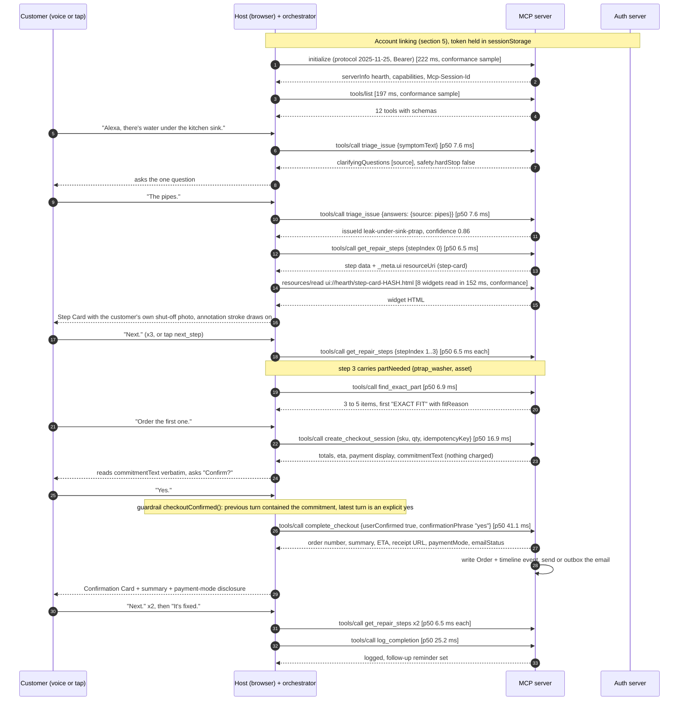
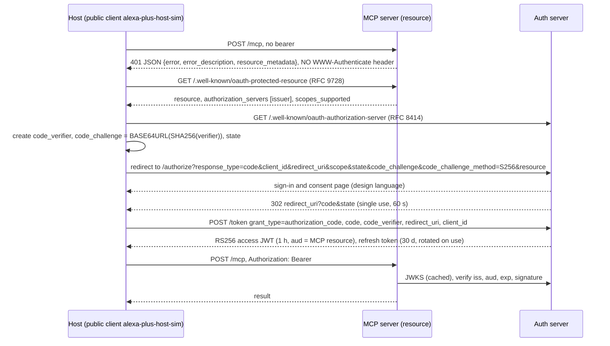

# Architecture

Hearth is a self-hosted MCP server (the Alexa+ add-on) plus the pieces needed to run and judge it without an Alexa device: an OAuth 2.1 authorization server and a simulated Alexa+ host that is a genuine MCP client. This document says what each part is, which frozen contract governs it, and how a request flows through. Anything not built or not exercised is stated as such; the list is in the [README](../README.md#stretch-status-and-what-is-not-built).

## 1. Components

| Component | Path | Runtime | Responsibility |
|---|---|---|---|
| MCP server | [`apps/mcp-server`](../apps/mcp-server) | Node 22, Express 5, `@modelcontextprotocol/sdk@1.32.1` | `/mcp` Streamable HTTP (protocol 2025-11-25, stateful sessions), 12 tools, 8 `ui://hearth/*` widget resources, protected-resource metadata, bearer validation, UCP-shaped `/checkout-sessions`, `/receipts`, `/briefs`, `/media`, dev-only `/outbox` |
| Auth server | [`apps/auth-server`](../apps/auth-server) | Node 22, Express 5, jose | OAuth 2.1 Authorization Code + PKCE (S256), RFC 8414 metadata, JWKS, RS256 access tokens, rotating refresh tokens, sign-in and consent page |
| Simulated host | [`apps/host-sim`](../apps/host-sim) | Next.js 15, React 19 | Device frames, account-link screen, MCP Apps renderer, speech, inspector, `/api/orchestrate`, `/api/tts`, `/privacy`, `/terms` |
| Host runtime | [`packages/host-sim-core`](../packages/host-sim-core) | TypeScript library, browser and Node | `McpHostClient`, widget bridge, orchestrator turn loop, rules orchestrator, Ollama adapter, replays J1 to J5, traffic capture |
| Contracts | [`packages/contracts`](../packages/contracts) | zod | Every tool, widget, DB row, bridge message, auth and checkout shape |
| Playbooks | [`packages/playbooks`](../packages/playbooks) | TypeScript + YAML | 12 playbooks, synonym-table triage, safety hard-stop rules and messages, Bedrock guardrail policy JSON |
| Parts | [`packages/parts-catalog`](../packages/parts-catalog) | TypeScript + JSON | 59 SKUs, exact-fit matcher, 4-entry sample recall list |
| Home graph | [`packages/home-graph`](../packages/home-graph) | TypeScript | `HomeRepository`, `MemoryRepo` (JSON file), `DynamoRepo`, seed loader |
| Widgets | [`packages/widgets`](../packages/widgets) | Vite single-file builds | 8 presentational widgets, content-hashed, no network access |
| Design tokens | [`packages/design-tokens`](../packages/design-tokens) | TypeScript | `tokens.json` -> CSS variables |
| Infra | [`infra/cdk`](../infra/cdk) | AWS CDK 2.274 | Data, service and optional AgentCore stacks. Synth only. |

```
 Browser (apps/host-sim)                                  Node (apps/host-sim server routes)
 +---------------------------------------------+          +-----------------------------------+
 | McpHostClient --- JSON-RPC, Bearer -------------+      | POST /api/orchestrate             |
 | widget iframes <-> postMessage bridge       |   |      |   Bedrock | Ollama | rules        |
 | inspector (traffic log, latency badges)     |   |      |   + deterministic guardrails      |
 | account linking (PKCE, sessionStorage)  -------+|--+   | POST /api/tts  (Polly)            |
 +---------------------------------------------+   |  |   +-----------------------------------+
                                                   |  |
                          +------------------------v--+--------------+      +-------------------+
                          | apps/mcp-server                           |      | apps/auth-server  |
                          |  bearer auth (JWKS) -> Session(sub)       |<-----| JWKS, /token,     |
                          |  tools -> services -> repo                | JWKS | /authorize        |
                          +--------+----------+----------+------------+      +-------------------+
                                   |          |          |
                          home-graph    playbooks    parts-catalog      checkout -> Stripe test | simulated
                          (JSON|DDB)    + safety                        email    -> Resend | .eml outbox
```

Design decision 4 in [DECISIONS.md](DECISIONS.md): the MCP client runs in the browser, so the inspector shows real JSON-RPC from the host the way an Alexa device would send it. The server-side `/api/orchestrate` route only decides the next step; it never calls Hearth.

## 2. Frozen contracts C1 to C7

Contracts were fixed before parallel work started; no lane changed one without the orchestrator.

| Id | Contract | File | Notes |
|---|---|---|---|
| C1 | Tool schemas (12 tools: input, output, scope, widget, annotations) | [`packages/contracts/src/tools.ts`](../packages/contracts/src/tools.ts) | The same zod schema generates the MCP `inputSchema` and `outputSchema`. No hand-copied JSON Schema. |
| C2 | Widget payloads | [`packages/contracts/src/widgets.ts`](../packages/contracts/src/widgets.ts) | Tool outputs are exactly the widget props. Widgets validate on receipt. |
| C3 | Home Graph rows, key builders, `HomeRepository` | [`packages/contracts/src/db.ts`](../packages/contracts/src/db.ts) | No health or child fields exist in the schema (Alexa+ policy). |
| C4 | Host bridge protocol | [`packages/contracts/src/bridge.ts`](../packages/contracts/src/bridge.ts), runtime in [`packages/host-sim-core/src/bridge.ts`](../packages/host-sim-core/src/bridge.ts) | `ui/ready`, `ui/hostContext`, `ui/render`, `ui/resize`, `ui/action`, `ui/voice-intent`, `ui/error` |
| C5 | Auth | [`docs/AUTH.md`](AUTH.md), [`packages/contracts/src/auth.ts`](../packages/contracts/src/auth.ts) | Endpoints, scopes, token claims, 401 shape |
| C6 | Checkout | [`docs/CHECKOUT.md`](CHECKOUT.md), [`packages/contracts/src/checkout.ts`](../packages/contracts/src/checkout.ts) | UCP-shaped REST and the two tools over the same service |
| C7 | Design tokens | [`packages/design-tokens/tokens.json`](../packages/design-tokens/tokens.json) | Widgets and host consume it; a test fails on hard-coded values in widgets ([`packages/widgets/test/tokens-only.test.ts`](../packages/widgets/test/tokens-only.test.ts)) |

Amendments are recorded one line each in [DECISIONS.md](DECISIONS.md) (for example #12: `complete_checkout` input adds `confirmationPhrase`; #10: an eighth widget, `recall-card`).

## 3. MCP surface

- Transport: `POST /mcp` (JSON-RPC, and the initialize that opens a session), `GET /mcp` (server-sent stream), `DELETE /mcp` (end session). Session id in `Mcp-Session-Id`. A session is bound to the token's `sub`; another account gets 403.
- `initialize` advertises protocol `2025-11-25` and the `tools`, `resources` and `logging` capabilities.
- Every tool has a `title`, an LLM-oriented `description` (when to call, what it returns, what to say next), `inputSchema`, `outputSchema` and annotations (`readOnlyHint`, `destructiveHint`, `idempotentHint`, `openWorldHint`).
- Visual tool results carry text for voice-only devices in `content[]`, the typed data in `structuredContent`, and the widget link in `_meta` (`ui.resourceUri` plus `ui.csp`, and legacy `mcpApp` keys; see the friction log on why both).
- Errors are `isError: true` with a voice-safe message and `structuredContent.error.code` (`not_found`, `not_confirmed`, `forbidden_scope`, `session_expired`, ...). Stack traces and SKUs never reach voice text.
- Widgets are resources `ui://hearth/<widget>-<hash>.html` with mime type `text/html+mcpapp`. The content hash makes URIs cacheable; they change when a widget is rebuilt.
- Every write tool takes an `idempotencyKey`; the stored result is returned on replay (`IDEM#<userId>` rows).

## 4. Sequence of J1 (water under the kitchen sink)

Journey J1 is replayed by [`packages/host-sim-core/src/replays.ts`](../packages/host-sim-core/src/replays.ts) and must produce exactly this tool sequence (the replay fails otherwise). Latencies are the p50 full client round trips per tool from [`apps/mcp-server/reports/latency.md`](../apps/mcp-server/reports/latency.md): 50 timed calls each on localhost with a JSON-file repo. They are typical values for each call type, not a trace of a single J1 run. `initialize`, `tools/list` and `resources/read` are single samples from the conformance report.



Sum of the p50 tool round trips in the sequence above is roughly 7.6 + 7.6 + 4 x 6.5 + 6.9 + 16.9 + 41.1 + 2 x 6.5 + 25.2 = 144 ms across the whole journey (arithmetic on the report's p50 values; the browser run adds rendering and, in model modes, orchestrator time). The slowest single call is `complete_checkout` at p95 52.7 ms.

## 5. Auth flow

Contract: [AUTH.md](AUTH.md). Code: [`apps/auth-server/src`](../apps/auth-server/src) (`authorize.ts`, `tokens.ts`, `keys.ts`), [`apps/mcp-server/src/auth`](../apps/mcp-server/src/auth) (`jwt.ts`, `middleware.ts`), [`apps/host-sim/src/lib/auth.ts`](../apps/host-sim/src/lib/auth.ts).



Rules that matter:

- Public client, no secret, S256 only. `plain` or missing PKCE, an unregistered `redirect_uri` or an unknown client is rejected; an unknown client or redirect gets an error page and is never redirected to.
- No dynamic client registration, no CIMD, no OIDC. The `sub` claim (user id) is the only continuity key, matching Alexa+'s "based on previous conversations" model.
- Scopes: `home:read`, `home:write`, `orders:write`. A valid token without the scope a tool needs gets `isError` with `forbidden_scope` and JSON-RPC stays 200.
- The 401 deliberately has no `WWW-Authenticate` header, per the Alexa+ add-on checklist. This breaks generic OAuth clients that discover the authorization server from that header; the consequence is in the [friction log](FRICTION_LOG.md) and is why Claude Desktop uses a minted development token.
- Dev token: `pnpm --silent --filter @hearth/auth-server mint-dev-token` mints a 1 hour token with every scope for `usr_okafor`.

## 6. Checkout flow

Contract: [CHECKOUT.md](CHECKOUT.md). Code: [`apps/mcp-server/src/services/checkout.ts`](../apps/mcp-server/src/services/checkout.ts), [`payments.ts`](../apps/mcp-server/src/services/payments.ts), [`email.ts`](../apps/mcp-server/src/services/email.ts), [`apps/mcp-server/src/http/checkout.ts`](../apps/mcp-server/src/http/checkout.ts).

```
create_checkout_session / POST /checkout-sessions        (scope orders:write)
   price item: tax 8.25%, free shipping (Prime household), ETA = today + SKU shipDays, skip Sunday
   payment: stripe_test PaymentIntent (unconfirmed)  OR  pi_sim_* simulated
   store CheckoutSessionRow  status ready_for_complete   (expires in 30 min)
   return commitment_text   "You're ordering 1x NAME for $TOTAL, arriving DAY. Paid with Visa ending 4242."
        |
   host reads commitment_text verbatim, asks "Confirm?", waits for the customer's own explicit yes
        |
complete_checkout / POST /checkout-sessions/:id/complete
   requires user_confirmed true AND non-empty confirmation_phrase  -> else not_confirmed / HTTP 400
   confirm the PaymentIntent or mark the simulated one paid
   write Order row + order timeline event
   email: Resend if keyed, else .eml in apps/mcp-server/.outbox (listed at /outbox)
   return order id and number, summary, ETA, support email, receipt URL, charged amount, paymentMode
   same idempotency_key -> stored response, no second order
```

The payment method is `stored_payment_method` and only a display string is held. Amazon Wallet `network_token` needs Amazon Pay merchant onboarding and is not implemented. `paymentMode` is `stripe_test` or `simulated` and is always shown to the customer.

## 7. Safety layers

Full model: [SAFETY.md](SAFETY.md). The rule is that safety is deterministic first and probabilistic second: a language model never decides whether a hard stop applies and never words it.

| Layer | Where | Nature | Status |
|---|---|---|---|
| 1. Hard-stop rules (gas, electrical, structural, flooding, sewage, child involved) | [`packages/playbooks/src/safety`](../packages/playbooks/src/safety), run inside `triage_issue` before any question or step | Deterministic keyword and pattern table, verbatim messages in `messages.ts` | Tested, including a 24-prompt red-team list ([`redteam.test.ts`](../packages/playbooks/test/redteam.test.ts)) |
| 2. Verbatim rule | `guardrails()` in [`apps/host-sim/src/server/orchestrate.ts`](../apps/host-sim/src/server/orchestrate.ts) | Replaces any model decision with `safety.message` | Tested ([`orchestrate.test.ts`](../apps/host-sim/src/server/orchestrate.test.ts)) |
| 3. Escalation | Playbook `escalateIf` plus `TriageOutput.escalate` | Deterministic, routes to `prepare_pro_brief` | Tested |
| 4. Bedrock Guardrails | [`packages/playbooks/safety/bedrock-guardrail.json`](../packages/playbooks/safety/bedrock-guardrail.json), created by [`infra/cdk/lib/guardrail.ts`](../infra/cdk/lib/guardrail.ts) | Probabilistic classifier | Policy and CDK resource exist. The host's Converse call does not yet pass a `guardrailConfig`. Never run against AWS. |
| 5. Commerce guard | `checkoutConfirmed()` in the orchestrator, `not_confirmed` in the checkout service | Deterministic | Tested; no charge without a read-aloud commitment and an explicit yes |

## 8. Data model (single table)

Key builders live in [`packages/contracts/src/db.ts`](../packages/contracts/src/db.ts) (`Keys`). The default repository is a JSON file with the same logical keys; `DynamoRepo` ([`packages/home-graph/src/dynamo-repo.ts`](../packages/home-graph/src/dynamo-repo.ts)) is selected when `HEARTH_DDB_TABLE` is set.

| Entity | PK | SK | Key attributes |
|---|---|---|---|
| Home | `USER#<userId>` | `HOME#<homeId>` | name, city and state only, yearBuilt, climateZone, timezone, heatingFuel |
| Asset | `HOME#<homeId>` | `ASSET#<assetId>` | type, category, label, brand, model, serial, installDate, location, photos with annotation coordinates, attributes (for example trapSize, filterSize), consumables |
| Issue | `HOME#<homeId>` | `ISSUE#<ts>#<issueRecordId>` | symptomText, playbookId, assetId, status, answers, stepsCompleted |
| Order | `HOME#<homeId>` | `ORDER#<ts>#<orderId>` | sku, qty, total, status, checkout session id, payment intent id, payment mode |
| Event (timeline) | `HOME#<homeId>` | `EVENT#<ts>#<eventId>` | type, assetId, summary, cost, photos. Also written to GSI1 for per-asset history. |
| ProBrief | `HOME#<homeId>` | `BRIEF#<briefId>` | assetId, issueId, rendered payload, public token |
| Task | `HOME#<homeId>` | `TASK#<dueDate>#<taskId>` | assetId, kind, dueDate, priority, reorder SKU |
| CheckoutSession | `HOME#<homeId>` | `CHECKOUT#<sessionId>` | status, line items, totals, commitment text, expiry |
| Idempotency | `IDEM#<userId>` | `KEY#<key>` | stored tool result |
| GSI1 | `ASSET#<assetId>` (`GSI1PK`) | `EVENT#<ts>` (`GSI1SK`) | per-asset history |

Policy encoded in the schema: city and state only (no street address), no health fields, no fields about children. `triage_issue` itself never writes an issue row. `prepare_pro_brief` does write an escalated Issue row and a brief containing the symptom text it is given ([`services/brief.ts`](../apps/mcp-server/src/services/brief.ts)); so the claim in SAFETY.md that a child-rule stop stores nothing holds only if the host does not follow the stop with a brief. This is an open item, not a verified guarantee. The seed home is "The Okafor House": 12 assets, 6 events, loaded on first boot.

Design finding recorded in the friction log: the contract's `HomeRepository` lacked `getOrder` (receipts use an index workaround) and the playbook `StepContext` lacked `now`; both were found by building against the contracts.

## 9. Widgets and the host bridge

Eight widgets: `step-card`, `parts-carousel`, `checkout-card` (two states), `weekend-list`, `pro-brief-card`, `home-card`, `timeline-list`, `recall-card`. They map to the four MCP Apps patterns (Card, Carousel, List; Map is unused). Each is one self-contained HTML file built by Vite (`vite-plugin-singlefile`) with a CSP of `default-src 'none'` and images allowed from the declared media origin only. Widgets are presentational: they receive `ui/render` props and never fetch.

Handshake: the widget posts `ui/ready`; the host answers `ui/hostContext` (device class, size, theme, safe area, capabilities) then `ui/render`. The widget re-lays out on context change and posts `ui/resize`. A tap posts `ui/action`, which the host turns into a user turn such as `[tap] next_step {json}`, so voice and touch converge on the same orchestrator path. The widget iframe is sandboxed (`allow-scripts`), so its origin is opaque and the host trusts only source-window identity.

## 10. Deployment (CDK)

Documented in [`infra/cdk/README.md`](../infra/cdk/README.md); nothing here has been deployed.

| Stack | Contents |
|---|---|
| `HearthData` | DynamoDB `hearth-home-graph` (PK/SK, GSI1, on-demand, PITR, retained), three Secrets Manager secrets |
| `HearthService` | VPC (public subnets, DynamoDB gateway endpoint, no NAT), ECS Fargate services for mcp-server, auth-server and optionally host-sim, one ALB, one CloudFront distribution per service for free HTTPS, SES identity, Bedrock guardrail |
| `HearthAgentCore` | Optional (`-c agentcore=true`): the mcp-server image as an AgentCore Runtime (protocol MCP, ARM64) and an AgentCore Memory store |

App Runner was rejected for three reasons recorded in the CDK README: a CloudFormation cycle between services that need each other's URL, no session affinity for stateful MCP sessions, and a request duration limit on long-lived streams. One task per service is deliberate because MCP sessions and OAuth codes are in process memory. Tests assert least-privilege IAM (no `*` actions, no `dynamodb:*`) and that secrets reach containers only through ECS `secrets`. CI ([`.github/workflows/ci.yml`](../.github/workflows/ci.yml)) runs typecheck, tests, conformance, bench and replays against a local stack; [`deploy.yml`](../.github/workflows/deploy.yml) is a manual deploy that has never run.
